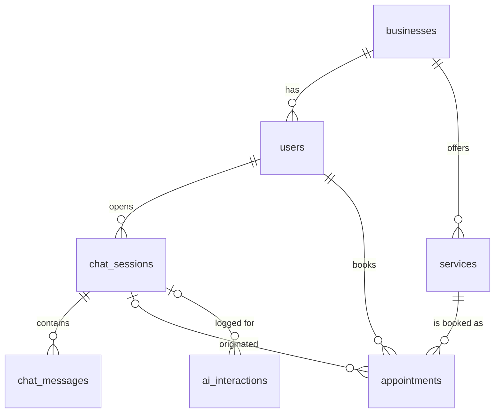

# Database design

PostgreSQL 14+. Files:

| File | Purpose |
|---|---|
| [`schema.sql`](./schema.sql) | DDL — tables, constraints, indexes, triggers. Idempotent (safe to re-run). |
| [`seed.sql`](./seed.sql) | Sample inserts: 2 tenants, services, users, appointments, a chat session, an AI log row. Idempotent. |

Apply both with `npm run db:migrate -- --seed` from the project root (or `psql -f database/schema.sql -f database/seed.sql`).

## Entity overview

| Table | Required by brief | Notes |
|---|---|---|
| `users` | ✅ | Auth + profile. Email unique **per business**. Role: customer / staff / admin. |
| `appointments` | ✅ | `starts_at`/`ends_at` as `timestamptz`, status lifecycle, `source` (chat / form / staff), link back to the chat that produced it. |
| `chat_sessions` | ✅ | Conversation metadata + `booking_state` (the slot-filling draft). |
| `chat_messages` | added | History normalised out of `chat_sessions` (see decision 3). |
| `businesses` | optional multi-tenancy | Tenant + its timezone, opening hours, slot interval, booking horizon. |
| `services` | added | What can be booked and for how long. Grounds the AI in real options. |
| `ai_interactions` | added | One row per LLM call: latency, tokens, status, raw + parsed output. |

## Key decisions

1. **Multi-tenancy by `business_id` on every row, enforced with composite foreign keys.**
   `users`, `services` expose `UNIQUE (business_id, id)`; child tables reference `(business_id, user_id)` and `(business_id, service_id)`.
   This makes it *impossible* for an appointment in tenant A to point at a user or service in tenant B — the database enforces tenant isolation, not just the `WHERE business_id = $1` in application queries. Cost: one extra unique index per parent table.

2. **Double booking is prevented by the database, not by a read-then-write check.**
   `appointments_no_overlap` is a GiST exclusion constraint on `(business_id WITH =, tstzrange(starts_at, ends_at) WITH &&)` for live statuses. Two concurrent requests for overlapping slots cannot both commit; the API maps the violation (SQLSTATE `23P01`) to `409 SLOT_UNAVAILABLE` and offers alternatives. The app still pre-checks availability for friendly messages, but correctness doesn't depend on it.
   *Assumption:* one bookable resource (one practitioner / chair) per business. Multiple staff would add a `resources` table and swap `business_id` for `resource_id` in the constraint.

3. **Messages in their own table rather than a JSON array on the session.**
   Appending to a growing `jsonb` array rewrites the whole value (TOAST) on every message and makes pagination awkward. A row per message keeps inserts O(1), allows keyset pagination (`id < $cursor`), and gives the LLM context window a cheap `ORDER BY id DESC LIMIT n` query. `chat_sessions` keeps denormalised `message_count` and `last_message_at` so the session list never has to aggregate messages.

4. **The booking draft lives in `chat_sessions.booking_state` (jsonb).**
   It's small, always read/written with the session, schema-light (stage, service, date, time, notes, clarification count), and lets a conversation resume on another device or after a server restart. Not indexed — never queried by content.

5. **Timestamps are `timestamptz` (UTC instants); the business timezone is data.**
   Opening hours are stored as local `time` + an IANA timezone on `businesses`, so "9am in Lahore" stays correct across DST changes in other zones and tenants in different countries work side by side.

6. **`CHECK` constraints instead of `ENUM` types for statuses.** Adding a value to a `CHECK` is a simple constraint swap; removing an `ENUM` value requires recreating the type. Also: lower-cased emails enforced by `CHECK (email = lower(email))` so a plain unique index works (no functional index, no `citext` extension).

7. **Idempotent user messages.** The browser sends a `client_message_id` (UUID) with each message; a partial unique index on `(session_id, client_message_id)` turns network retries into a `409` instead of a duplicate message and a duplicate LLM call.

8. **Identity `bigint` keys for append-only, high-volume tables** (`chat_messages`, `ai_interactions`): smaller and strictly increasing (good for ordering and B-tree locality). UUIDs for entities that are exposed in URLs or created by multiple writers.

## Indexing strategy

Every index maps to a concrete query in the API:

| Index | Serves |
|---|---|
| `users_business_email_key` (unique) | Login: `WHERE business_id = $1 AND email = $2` |
| `services_business_active_idx` (partial `WHERE is_active`) | Service picker / AI context for a tenant |
| `chat_sessions_user_recent_idx (user_id, last_message_at DESC)` | "My conversations", newest first, no sort step |
| `chat_messages_session_id_idx (session_id, id)` | History + keyset pagination; last-N window for the LLM |
| `chat_messages_client_id_uidx` (partial unique) | Idempotency of message POSTs |
| `appointments_user_starts_idx (user_id, starts_at)` | "My upcoming / past appointments" (range scan in either direction) |
| GiST behind `appointments_no_overlap` | Overlap checks for availability: `tstzrange(starts_at, ends_at) && tstzrange($day_start, $day_end)` |
| `appointments_business_live_starts_idx` (partial, live statuses) | Staff day/calendar view; excludes cancelled history |
| `appointments_service_idx`, `appointments_chat_session_idx` | FK lookups — avoids sequential scans when a service/session is deleted |
| `ai_interactions_session_idx`, `…_business_created_idx`, `…_failures_idx` (partial) | Per-conversation debugging, per-tenant analytics, failure triage |

Partial indexes are used where queries only ever touch a subset (active services, live appointments, failed AI calls), which keeps them small and cheap to maintain.

## Performance considerations

- **Hot paths are single-index lookups.** Sending a chat message = 1 session lookup by PK, 1 insert, 1 `LIMIT 12` window read, 1 insert, 1 update. Availability = 1 GiST range probe per day.
- **Connection pooling.** The API uses a `pg` pool (default 10). On serverless/managed Postgres (Neon, Supabase) put PgBouncer / the provider pooler in front; all queries are simple parameterised statements so transaction pooling works.
- **No long transactions around LLM calls.** The AI call (1–3 s) happens *outside* any transaction; only the short write of the assistant reply + session state is transactional. Holding row locks across a network call would serialise users and exhaust the pool.
- **Growth.** `chat_messages` and `ai_interactions` are the only unbounded tables. At scale: range-partition them by `created_at` (monthly) and drop/archive old partitions per retention policy; `ai_interactions` also stores prompts that contain user text, so it should get a short retention window (e.g. 30–90 days) for privacy.
- **Write amplification.** `updated_at` triggers are per-row and cheap; `message_count` is maintained in the same UPDATE that sets `booking_state`, so there's no extra write per message.
- **Reads that will need caching later:** services and business settings (change rarely) — cache in-process with a short TTL once traffic justifies it.
- **Row-Level Security** is the natural next hardening step for multi-tenancy: `ALTER TABLE … ENABLE ROW LEVEL SECURITY` with a policy on `business_id = current_setting('app.business_id')::uuid`, set per request. Not enabled in the prototype to keep local setup simple.
